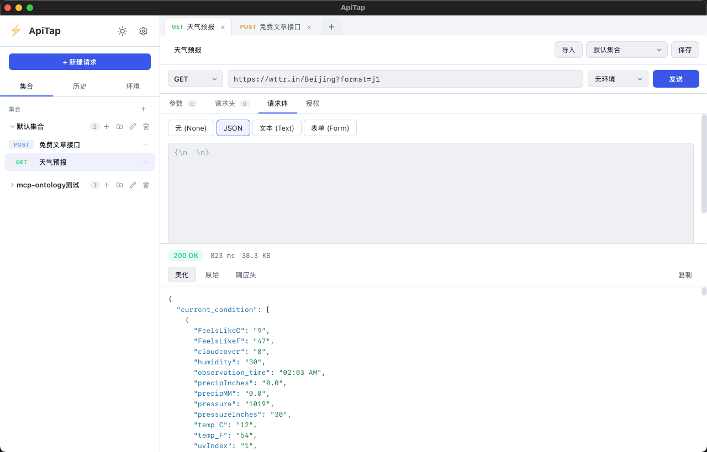
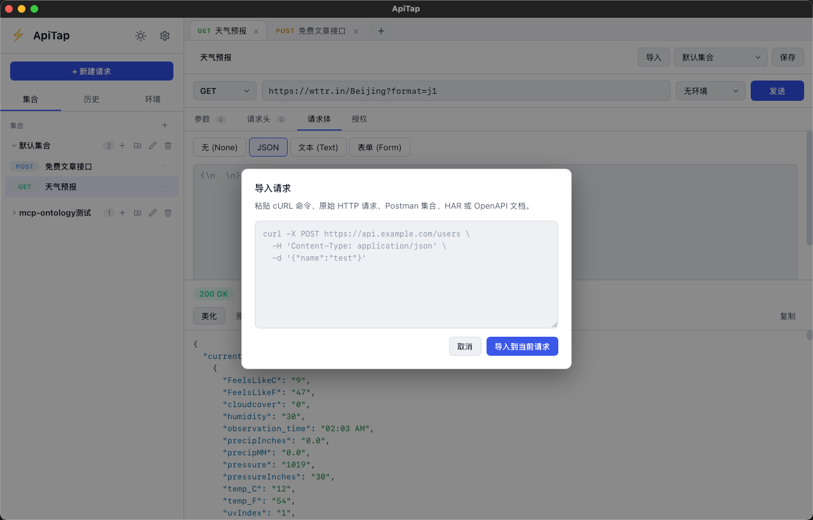

# ⚡ ApiTap

> Open Source Lightweight API Debugging & Testing Tool — A Modern Postman Alternative for Developers.

**ApiTap** 是一款开源、轻量、原生跨平台的 API 调试与测试工具。无需登录、无需注册，**打开即用**。所有数据（请求集合、历史、环境变量）都只保存在你本机，不会上传到任何服务器。

- 🪶 **轻量原生**：基于 [Tauri 2](https://tauri.app/)（Rust），安装包体积小、内存占用低，告别 Electron 的臃肿。
- 🚀 **现代技术栈**：前端使用 [Vue 3](https://vuejs.org/) + [TypeScript](https://www.typescriptlang.org/) + [Vite 8](https://vitejs.dev/)；后端使用 Rust + [reqwest](https://docs.rs/reqwest)。
- 🔓 **无需登录**：所有数据本地存储，隐私优先。
- 🧩 **功能齐全**：多种请求方法、参数 / 请求头 / 请求体 / 授权管理、JSON 美化、响应耗时与体积统计、集合与历史、环境变量 `{{变量}}` 替换、明暗双主题。

---

## ✨ 功能特性

| 功能 | 说明 |
| --- | --- |
| 请求方法 | GET / POST / PUT / PATCH / DELETE / HEAD / OPTIONS |
| 查询参数 | 可视化的键值对编辑器，自动拼接到 URL |
| 请求头 | 可视化编辑，支持启用 / 禁用 |
| 请求体 | 支持 `none` / `JSON` / `文本` / `表单(x-www-form-urlencoded)` |
| 授权 | `None` / `Bearer Token` / `Basic Auth` / `API Key`（可放 Header 或 Query） |
| 响应展示 | 状态、耗时、体积统计；美化 / 原始 / 响应头 三种视图；JSON 语法高亮 |
| 集合（Collections） | 保存、重命名、删除请求，归类管理 |
| 历史记录 | 自动记录每次请求（含失败请求），支持搜索、一键重放、存为集合请求、清空 |
| 环境变量 | 定义变量并在 URL / 头 / 体中用 `{{变量名}}` 引用，一键切换环境 |
| 主题 | 内置暗色 / 亮色主题，自动记忆 |
| 本地持久化 | 基于 Rust 写入应用配置目录的 JSON 文件，重启不丢失 |

---

## 🖼️ 界面预览

### 主界面布局

左侧为集合 / 历史 / 环境侧边栏，中间为请求配置区（方法 + URL + 参数 / 请求头 / 请求体 / 授权），下方为响应展示区（状态码、耗时、体积、美化 / 原始 / 响应头）。



### 导入请求

点击顶部「导入」，可粘贴 cURL 命令、原始 HTTP 请求、Postman 集合、HAR 或 OpenAPI 文档，一键导入到当前请求。



---

## 🧱 技术栈

| 层 | 技术 |
| --- | --- |
| 桌面壳 | Tauri 2（Rust） |
| 前端框架 | Vue 3 `<script setup>` + TypeScript |
| 构建工具 | Vite 8 |
| HTTP 客户端 | Rust `reqwest`（在原生层发送，避免 WebView 的 CORS 限制） |
| 本地存储 | Rust 文件系统（`app_config_dir`） |

> 为什么用 Rust 发送请求？在 WebView 中直接用 `fetch` 会受到浏览器同源策略 / CORS 限制，导致大量 API 无法访问。ApiTap 把请求放到 Rust 原生层执行，既能访问任意地址，也能精确统计响应耗时与字节大小。

---

## 📦 环境要求

- **Node.js** ≥ 18（推荐 20+）
- **Rust** 工具链（安装 [rustup](https://rustup.rs/) 即可，需包含 `stable` 与对应平台 target）
- 操作系统：Windows / macOS / Linux（桌面端）

---

## 🛠️ 安装与运行

```bash
# 1. 安装前端依赖
npm install

# 2. 开发模式（热重载，会启动一个原生窗口）
npm run tauri dev

# 或者仅启动前端（在浏览器中预览 UI，此时 HTTP 请求不可用）
npm run dev

# 3. 打包为可执行文件（生成到 src-tauri/target/release/ 及打包产物）
npm run tauri build
```

> 首次 `npm run tauri dev` / `build` 会自动用 `cargo` 编译 Rust 后端，请耐心等待。

---

## 📖 使用指南

1. 在顶部地址栏选择**请求方法**并输入 **URL**（例如 `https://api.github.com/users/octocat`）。
2. 通过 **参数 / 请求头 / 请求体 / 授权** 标签页配置请求细节。
3. 点击 **发送**。响应会出现在下方，包含状态码、耗时、大小、美化后的内容。
4. 点击 **保存** 把当前请求存入左侧某个集合；点击 **新建请求** 清空开始新的调试。
5. 在 **历史** 标签页可搜索过往请求，双击或右键「重新发送」直接重放，右键「保存到集合」可把它沉淀为正式请求。
6. 在 **环境** 标签页新建环境并添加变量，URL / 头 / 体中用 `{{变量名}}` 引用，顶部下拉框切换当前环境。

---

## 🗂️ 项目结构

```
ApiTap1/
├── index.html                 # 入口 HTML
├── package.json               # 前端依赖与脚本
├── vite.config.ts             # Vite 配置（端口 1420，固定端口供 Tauri 使用）
├── tsconfig*.json             # TypeScript 配置
├── docs/
│   └── screenshots/           # README 展示截图（不参与打包）
├── src/                       # 前端源码（Vue 3 + TS）
│   ├── main.ts                # 应用入口
│   ├── App.vue                # 根组件 / 整体布局
│   ├── style.css              # 全局样式与主题变量
│   ├── types.ts               # 共享类型定义
│   ├── store.ts               # 响应式状态管理 + 持久化
│   ├── lib/
│   │   ├── format.ts          # 工具函数（变量替换、JSON 高亮、格式化等）
│   │   └── http.ts            # 调用 Rust 命令的封装
│   ├── components/            # UI 组件
│   │   ├── Sidebar.vue        # 侧边栏（集合 / 历史 / 环境）
│   │   ├── UrlBar.vue         # 方法 + URL + 环境 + 发送
│   │   ├── RequestTabs.vue    # 参数 / 请求头 / 请求体 / 授权 标签页
│   │   ├── KeyValueEditor.vue # 通用键值对编辑器
│   │   ├── BodyEditor.vue     # 请求体编辑器
│   │   ├── AuthEditor.vue     # 授权编辑器
│   │   ├── ResponsePanel.vue  # 响应展示
│   │   └── JsonViewer.vue     # JSON 语法高亮
│   └── assets/
└── src-tauri/                # Rust 后端（Tauri 2）
    ├── Cargo.toml
    ├── tauri.conf.json        # Tauri 配置（窗口、图标、构建命令）
    ├── build.rs
    ├── capabilities/          # 权限能力配置
    ├── icons/                 # 应用图标
    └── src/
        ├── main.rs
        └── lib.rs             # send_request / get_data / set_data 命令
```

---

## 💾 数据存储位置

所有数据保存在各平台的**应用配置目录**：

- **macOS**：`~/Library/Application Support/com.apitap.app/*.json`
- **Windows**：`%APPDATA%\com.apitap.app\*.json`
- **Linux**：`~/.config/com.apitap.app/*.json`

包含：`collections.json`、`environments.json`、`history.json`、`current.json`、`theme.json`、`activeEnvId.json`。

> 删除这些文件即可清空所有本地数据。

---

## 🎨 自定义图标

默认图标位于 `src-tauri/icons/`。替换为自己的图标后，在该目录执行：

```bash
npm run tauri icon path/to/your-icon.png
```

Tauri 会自动生成各平台所需尺寸的图标。

---

## 📜 许可证

本项目基于 [GNU General Public License v3.0](https://www.gnu.org/licenses/gpl-3.0.html) 开源，许可证全文见仓库根目录的 [`LICENSE`](./LICENSE)。

- 你可以自由地运行、学习、修改本项目，并在任何场景（含商业）中使用。
- 分发本项目或其衍生作品时，必须同样以 GPL v3.0 发布，并保留原始版权声明与许可证文件。
- 衍生作品需明确标注其基于本项目修改而来。

> 依赖的第三方组件（Tauri、Vue、Vite 等）遵循各自的许可证协议。
